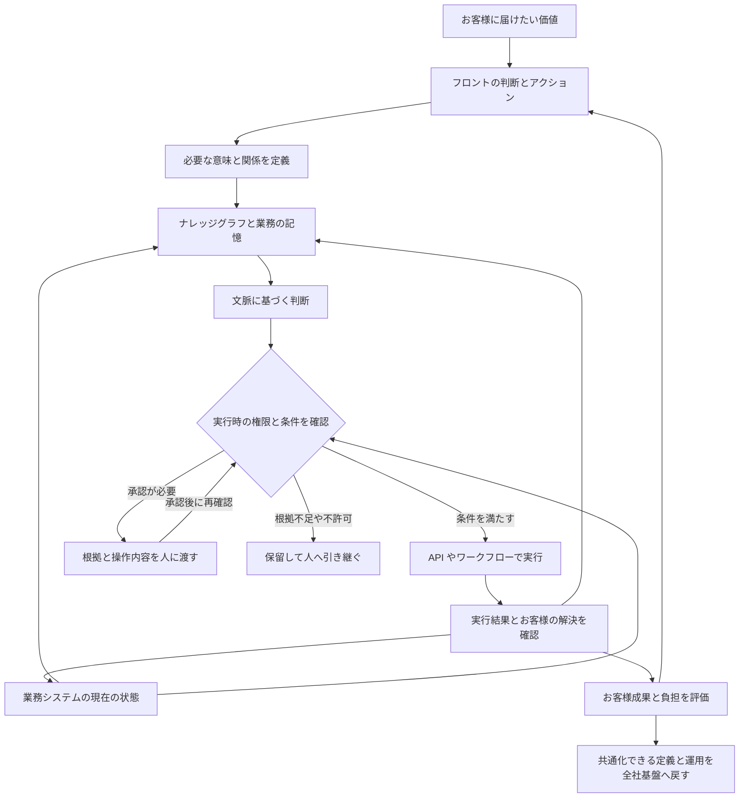

最近、大企業の CIO や CTO、CAIO の方々と話す中で、AI をどう事業の成果につなげるかという話になりました。「こういう話が聞きたい」と言われたこともあり、これまでこのブログで書いてきたことを顧客価値の側から整理してみます。

AI を導入して製品開発の速度が2倍になったり、質問の回答を作る時間が半分になったとします。それでもお客様の問題が解決するまでの時間が変わらなければ何が改善したと言えるでしょうか。

担当者の作業が速くなることには価値があります。ただ、その先で承認待ちが続いたり、誤った案内で問い合わせが増えたりすれば、お客様に届く価値は変わります。

AI は組織の仕事の進め方を増幅します。うまく設計された仕事には正のレバレッジがかかり、曖昧な判断や分断された情報には負のレバレッジがかかる。どちらを増幅するかは仕事の設計で決まります。

私が AI のレバレッジをかける変数として重視しているのは、**カスタマーフロントにいる人たちの判断と行動**です。営業、導入支援、サポート、フィールド、店舗など、お客様と向き合って価値を届ける人たちです。その人たちがお客様の状況を理解し、できる判断や対応が変われば、お客様の評価にも変化が表れます。

お客様の状況を把握したら、担当を割り当てて問題の解決を進めます。**状況の把握から判断、アクション、結果の確認までつなげること**を、設計の単位にします。

本記事では、全社の AI 戦略やデータ基盤、ガバナンスを担う立場の方に向けてその設計の順序を考えます。以下の業務例は、設計を説明するための仮想例です。

## 1. AI は正しい仕事も間違った仕事も増幅する

たとえば、契約更新が近いお客様から、同じ不具合について繰り返し問い合わせが来ている場面を考えます。

AI が契約条件、過去の対応、未解決の不具合、担当部門をつないで確認できれば、担当者が状況を組み立て直す時間を減らせます。さらに対応方針と権限に従って案件を担当部門へ割り当て、期限を設定し、承認された回避策をお客様に案内するところまで進めれば、お客様が待たされている仕事そのものを動かせます。

ここで「解約リスクがあります」と表示するだけなら、その先は人が調べ直して動く必要があります。リスクを見つけた後に誰が何を実行し、お客様が仕事を再開できたかを確認するところまでつながって、初めて改善がお客様に届きます。

この流れをお客様の側から見ると、「誰が、いつまでに、何をしてくれるのか」という約束になります。たとえば「金曜日までに回避策をご案内します」と伝えたなら、担当部門と実行できる期限を確認し、その約束どおりに案内を届ける必要があります。案内後には、お客様が実際に仕事を再開できたかも確かめます。社内で回答案ができただけでは、お客様との約束を果たしたことにはなりません。

解決の時期がまだ分からない場合も、「明日の午後に調査状況をご連絡します」と、次に連絡する時期は決められます。AI に任せる仕事も、回答を作るところから、こうした約束を記録し、担当者につなぎ、対応の抜けを見つけるところまで広げて考えます。

一方で、古い手順書だけを参照して回答を自動送信すれば、同じ誤案内を大量に届けることもできます。回答件数は増えていても、お客様の手間と現場の再対応は増えるかもしれません。

| 増幅するもの | 正のレバレッジ                   | 負のレバレッジ                             |
| ------------ | -------------------------------- | ------------------------------------------ |
| 情報の参照   | 必要な根拠を早く揃えられる       | 古い情報や別のお客様の情報を広く使ってしまう |
| 判断         | 条件の揃った案件を一貫して扱える | 曖昧な基準による誤判断を繰り返す           |
| 実行         | 許可された対応を待たせず進める   | 誤送信や権限外の変更を大量に行う           |

負のレバレッジには、手戻りの費用だけでなく、情報漏えいやお客様からの信頼の低下も含まれます。AI に渡す仕事の範囲を広げるほど、誤りが届く範囲も設計する必要があります。

**お客様に届いた改善と、そのために増えた確認・再対応・運用の負担を一緒に評価します。**

## 2. ベストプラクティスを実装した先で何が違いになるのか

LLM ベンダーが示す、プロンプトの書き方、検索の組み込み方、ツールの呼び出し方、評価の進め方は、共通の実装課題を解くために役立ちます。

公開された方法は他社も採用できます。私はこの部分を、競争に参加するためのコモディティへの対応と捉えています。差別化は、その土台の上に自社のお客様が選ぶ理由を作ることです。

ドラフト作成や資料の整理が楽になることは確かに有用です。ただ、同じ効率化を競合も進めれば、それを導入しただけで優位に立ち続けることは難しくなります。「やれば儲かる施策」というより、「やらなければ相対的に不利になる土台」と考えています。LLM ベンダーが提供する共通の能力を使い、自社ならではの価値を作ります。

違いが出るのは、たとえば次のような判断です。

- 自社のお客様は、どこで仕事を止められているのか
- 何を把握すれば、お客様ごとに次の対応を変えられるのか
- どの対応まで AI に任せると、お客様にとって早く、確かな体験になるのか
- 対応から得た知見を、製品や次のお客様対応にどう戻すのか

同じモデルと同じ実装手法を使っても、お客様の状況をどう捉え、何を実行できるかで結果は変わります。その違いを作る材料が、自社のドメイン知識とお客様・業務のデータです。知識を言語化し、データを AI が扱える量と形に整え、お客様対応の判断とアクションに結びつけます。

## 3. データを集めることとAI が使えることには距離がある

大企業には長年ためてきたデータがあり、それを扱うデータエンジニアや基盤もあります。「これだけデータがあるのだから、整理して AI に使わせれば何かできるはず」と考えたくなります。

全社のデータをデータレイクに集め、品質や管理方法を揃えることには長期的な価値があります。部門ごとに繰り返している整備を共通化でき、分析や監査にも使える土台になります。

ただし、全社の整備完了をお客様向け AI の出発条件にすると、成果が届くまでに時間がかかります。AI が必要な情報を選べるよう、意味と関係も整えます。

実際の業務データには表記の揺れ、重複、古い記録、欠損、互いに矛盾する記述が含まれます。大量の記録をそのまま一度の入力に渡すことにも限界があります。仕事に必要な事実と単なるノイズを区別せずに渡せば、無関係な情報や古い判断に引かれたり、お客様固有の事情を落とした一般論しか返せなかったりします。データ量が多いことと、よい判断ができることは別です。

先ほどの契約更新の例なら、そのお客様の現在の契約、未解決の問い合わせ、関係する不具合、適用できる対応方針を揃えます。過去の契約が必要になる場合もありますが、現行契約と区別して取り出せる必要があります。

AI に渡す情報は、少なくとも次の 3 つから考えます。

| 観点 | 設計すること                                                        |
| ---- | ------------------------------------------------------------------- |
| 量   | 判断に必要な情報を揃え、無関係な履歴を混ぜすぎない                  |
| 形   | お客様 ID、契約状態、発生日時、根拠などを区別して取り出せるようにする |
| 文脈 | 誰の、いつの、どの製品・契約に適用される情報かを保つ                |

返金可否の判断なら、適用条件と例外条件を揃えます。判断に必要な根拠を保ちながら、仕事に関係する範囲へ情報を絞ります。

この文脈を毎回ばらばらのシステムから集め、同じお客様か、どの契約に属するかを LLM に推測させていては、仕事のたびに組み立て直すことになります。繰り返し使う実体と関係は名寄せして保持し、更新を取り込んでおく。AI はそこから今回の判断とアクションに必要な範囲を取り出します。

対象の仕事に必要な意味と関係を共有し、各業務システムの正しい記録へ参照をつなぎます。契約や取引の現在値は元の業務システムを正とし、実行時に最新の状態を確認します。

まずお客様対応の一つの流れで必要な情報を定義し、使いながら不足を確かめる。その結果を全社のデータ基盤にも戻す。この進め方なら、長期の整備と足元の成果をつなげられます。事前統合と同期の設計は、既存記事の[AIエージェントが毎回データを取りに行く設計の限界](https://zenn.dev/knowledge_graph/articles/kg-agent-memory-first-design)で扱っています。

## 4. お客様と対価からフロントの仕事を再設計する

トップダウンで顧客価値を定義するため、まず次の 3 つを掘り下げます。

- お客様は誰か
- そのお客様は何に対価を支払っているのか
- 社内の誰がお客様と向き合い、その価値を届けているのか

同じ製品を契約していても、お客様が求める成果は違います。あるお客様は早い導入を重視し、別のお客様は業務を止めずに切り替えることを重視します。お客様の事情に合わせて支援を変えるのがフロントの仕事です。

ここから、AI が使えることを前提にあるべき姿とプロセスを再定義します。お客様が事情を繰り返し説明する工程をまとめ、担当者の情報収集や部門間の引き継ぎにかかる待ち時間を減らします。人が引き受ける判断、AI に任せる処理、承認と実行の境界を組み直します。

たとえば「お客様が使い始めてから、最初の成果を得るまでを短くする」という目標なら、初期設定で止まる理由、問い合わせの引き継ぎ、回答後にお客様が作業を再開できたかを見ます。

| 届けたい顧客価値               | フロントの変化を見る指標                     | 確かめたい事業成果 |
| ------------------------------ | -------------------------------------------- | ------------------ |
| 導入後に早く成果を得られる     | 初期設定の完了率、最初の成果までの日数       | 利用定着、更新率   |
| 問題が起きても仕事を再開できる | 解決時間、再問い合わせ率、引き継ぎ回数       | 満足度、解約率     |
| 自分に合う提案を受けられる     | 要件確認の漏れ、提案の適合度、合意までの日数 | 成約率、売上       |

変えたいのはカスタマーフロントの判断と行動で、表に挙げた完了率や解決時間はその変化を確かめる指標です。回答時間、再問い合わせ率、解決後の満足度を組み合わせて、対応の速さと解決の質を評価します。

さらに、お客様に約束した期限を守れたか、予定が変わる場合に期限を過ぎる前に知らせたかも確認します。期限を長く設定すれば守りやすくなるため、期限を守った割合だけでなく、解決までにかかった日数も一緒に見ます。予定変更を知らせたことと、当初の約束を果たしたことも区別します。お客様が「どうなっていますか」と何度も問い合わせなくて済む状態を目指します。

開発自動化やバックオフィスの効率化にも価値はあります。開発で削減した時間を、お客様が必要な修正を早く受け取れるという価値へつなげます。カスタマーフロントを起点にすると、社内の改善がお客様へ届いたかを確かめやすくなります。

売上や解約率は、価格、製品の品質、季節性などにも左右されます。AI の効果を見極めるため、導入前の基準を残し、可能なら条件の近い未導入のお客様や段階導入の結果と比較します。解約率のように結果が出るまで時間がかかる指標は、途中の利用定着や未解決案件も追います。

改善したい指標と、フロントで変える判断・行動を対応づけます。初期設定の完了率を上げたいなら、止まっている手順を特定して支援を開始する。解決時間を短くしたいなら、関係する不具合と担当チームを特定して対応を割り当てる。提案の適合度を上げたいなら、未確認の要件を次の確認事項に反映します。

カスタマーフロントを起点に、製品や開発側も含めて解決までの仕事をつなぎます。複数のお客様が同じ不具合で止まっていると分かれば、対応の優先順位を見直す材料になります。修正されたら対象のお客様への案内と解決確認まで戻します。

顧客価値から目標を決め、現場で仮説を確かめる。この往復が、全社方針と現場の改善をつなぎます。

同じ回避策や特別な対応が何度も必要になるなら、その場を乗り切るだけでなく、製品や仕事の進め方を見直す材料にします。たとえば、導入のたびに同じ設定を担当者が手作業で直しているなら、初期設定や導入手順を変えられないかを考えます。AI で対応を楽にすることに加えて、その対応自体を減らすことも改善です。繰り返している対応の件数と、原因を取り除く改善につながったかを追います。

## 5. 少数の社員の頭にある知識を言語化する

お客様対応の違いを作るドメイン知識には、熟練者が経験で身につけた判断もあります。「この業界ではこの確認を先にしないと後で止まる」「この例外はこの条件なら対応できる」「このお客様は速度より業務を止めないことを重視している」。経験のある少数の社員だけが知っている判断があります。

その判断を AI や他の担当者も使えるように、判断の理由と適用条件を言語化します。

| 残すもの                   | お客様対応での例                                             |
| -------------------------- | ---------------------------------------------------------- |
| お客様が求める成果と優先順位 | 最短での導入より、既存業務を止めない移行を優先する         |
| 判断基準と理由             | 他部門の確認が必要な案件は、設定案内より先に担当者をつなぐ |
| 適用条件と例外             | どの契約・製品・期間に使える対応か、例外時は誰が判断するか |
| 根拠と管理責任             | どの記録に基づき、誰が確認し、いつ見直す知識か             |

言語化した経験則を無条件の正解として扱うのも危険です。個人の推測と確認済みの事実を分け、判断が分かれるものは責任者が確認します。お客様の事情も変わるので、いつの情報かを残して更新します。

そのうえでお客様、契約、製品、対応方針との関係を明示し、AI が必要な場面で使えるようにします。知識を文章にすることと、業務の中で使える意味構造にすることをつなぐ作業です。整備には手間がかかりますが、判断と結果を確かめながら蓄積することで、自社のお客様対応を支える資産になります。

## 6. シャドウ AI は満たされていないニーズのシグナル

会社が承認していない AI サービスを現場の担当者が仕事に使う。こうしたシャドウ AI は安全上の問題を含みます。お客様情報や機密情報の入力、保存・再利用条件の未確認、権限や利用記録の欠落などです。

同時にそこには現場が何を必要としているかという情報もあります。問い合わせを整理したい、複数の資料を読み比べたい、このお客様の事情に合う提案や例外対応を考えたい。フロントの人がお客様に応えようとして、正式な仕組みで満たされていない能力を自分で補っているのかもしれません。

ここで全社のデータを一度に AI から使えるようにしようとすると、個人情報、契約情報、社内機密をまとめて扱うため、利用目的とアクセス範囲の整理も大きくなります。整備や審査が長引いて必要な支援が届かなければ、現場が使いにくい公式環境を避け、個人の環境で補おうとする場合があります。データ整備の完了を待つ方針と現場のニーズが離れるほど、この問題に向き合う必要があります。

まず、どんな仕事に使われているのか、どんな情報が必要なのかを把握します。機密情報を入力せずに相談できる窓口を用意し、承認された環境で同じニーズを満たす方法を作る。その仕事に必要な文脈と操作へ範囲を絞り、権限と監査を効かせて使えるようにします。対象を絞ると、保護する情報と利用者の範囲を具体的に定義できます。

個人の環境で完結していた判断を、承認された仕組みで根拠と結果ごと残せれば、組織の知識にも戻せます。漏えいが疑われる場合の対応と、現場のニーズを正式な設計に取り込むことを両方進めます。

**現場のニーズを拾い、安全に使える公式環境へ取り込みます。**

## 7. ナレッジグラフを検索で終わらせずアクションにつなぐ

GraphRAG と、本記事で考えるナレッジグラフの使い方は目的が違います。

GraphRAG は、大量の文書から関連情報を取り出し、関係や全体の傾向を踏まえた回答を作るためにグラフを使います。[提案論文](https://arxiv.org/abs/2404.16130)でも、文書から作ったグラフとコミュニティの要約を使い、コーパス全体に関する質問へ答える方法が示されています。中心にあるのは、検索・要約・質問応答の改善です。

ここでナレッジグラフに担わせたいのは、**顧客、契約、製品、問い合わせ、不具合、担当者の関係を継続的に保持し、判断とアクションの共通基盤にすること**です。業務で同じ対象を指し、現在の状況と過去の対応を踏まえて次の仕事へ進めるようにします。

GraphRAG の検索結果をアクションの材料に使うこともできます。ただし対象の確定、実行権限、状態の更新、結果の記録は別途設計が必要です。検索の改善と、業務の判断・実行を支える意味と記憶の基盤は役割を分けて考えます。

たとえば契約更新前の不具合対応なら、次の流れをつなぎます。

1. お客様の契約と未解決の問い合わせから、関係する不具合と影響範囲を確認する
2. 対応方針に従って優先順位と次のアクションを判断する
3. 権限と承認条件を確認し、担当割り当て、対応期限の設定、お客様への案内を実行する
4. 実際の対応状況とお客様の解決確認を記録し、次の判断に使う

読みやすい回答やレポートが得られることにも価値はあります。ただ、そこで止まると実行までの手間は残ります。顧客価値を大きく変えるには、判断した内容が業務上のアクションになり、その結果を確認できるところまでつなぐ必要があります。人の承認を挟む場合も、根拠と具体的な操作を揃えて渡し、承認後の実行につなげます。

ナレッジグラフが関係と根拠を保持し、AI がアクションを選びます。権限と条件を確認する仕組みを通し、API やワークフローで実行します。提案中、実行済み、失敗などの状態を区別して記録します。この記録が、組織が次の仕事に使う記憶になります。

既存記事の[ナレッジグラフをエージェントの「記憶」にする設計](https://zenn.dev/knowledge_graph/articles/kg-agent-ontology-design)と[ツールを100個並べてもAIエージェントは賢くならない](https://zenn.dev/knowledge_graph/articles/kg-agent-skill-layer)は、この意味と記憶の基盤を扱っています。本記事では、その上で何を実行すると顧客価値が変わるかを設計の出発点に置いています。

## 8. オントロジーとガバナンスを最初から設計に入れる

お客様対応では営業の「お客様」が契約した法人を指し、サポートでは問い合わせをした利用者を指すことがあります。部門ごとの定義と対象を明示します。

オントロジーは、こうした概念の意味と関係を明示するために使えます。[W3C の OWL 2 概要](https://www.w3.org/TR/owl2-overview/)でも、オントロジーは用語とその関係を定義する語彙として説明されています。たとえば「利用者はどの法人に属し、その法人のどの契約で、どの製品を使っているか」を辿れるようにします。

オントロジーが概念や関係の定義で、その定義に沿って具体的なお客様や契約をつないだデータがナレッジグラフです。アクションにつなぐときは、どのお客様のどの契約に対して何を変更するかを、読む側と実行する側で一致させます。名前が似ているだけで別の契約を更新しないためにも、同一性と関係の定義が必要です。

実行したい仕事から逆算して必要な概念と関係を定義し、対象を広げながらモデルを育てます。[オントロジーはいつ必要か](https://zenn.dev/knowledge_graph/articles/when-ontology-helps-qa)では、少数の整理済みデータなら Markdown で質問に答えられることも確認しました。そこで比べたのは情報の渡し方です。複数のシステムが同じお客様や契約を指し、権限に従って状態を変更し続けるための設計は、別に考える必要があります。

お客様と契約の関係に加えて、誰がその契約を閲覧できるかを定義します。

言語化したドメイン知識にも同じ配慮が必要です。お客様対応の勘所、交渉方針、価格や例外処理の判断基準には、お客様自身や競合に公開できない内容もあります。契約情報と社内の判断基準には、それぞれ閲覧権限を設定します。**言語化することと、誰がどの範囲をどんな目的で使えるかを決めることはセット**です。

| 設計原則           | お客様対応での具体例                               |
| ------------------ | ------------------------------------------------ |
| 意味を揃える       | 契約者と利用者を分け、対象の契約と製品を特定する |
| 参照範囲を守る     | 担当者と AI が参照できるお客様・項目を検索時に絞る |
| 実行条件を明示する | 返金額や契約変更の条件を確認し、必要な承認へ回す |
| 根拠と責任を残す   | 参照元、提案、承認者、実行結果を記録する         |
| 止め方を用意する   | 根拠不足なら人に渡し、誤実行時は停止や復旧を行う |

権限は情報の取得側と API の実行側で検証します。閲覧できることと変更できることを分け、委任された AI が元の担当者を超える権限を使わないようにします。生成された要約にも元情報の閲覧範囲を引き継ぎます。お客様から届いた文章は判断の材料として扱い、そこに書かれた指示で社内の権限やルールを変更させません。

また、判断してから実行するまでに契約や権限が変わることもあります。実行直前に条件を再確認し、再試行で同じ処理を重複させない仕組みを用意します。取り消せない送信と元に戻せる更新を区別し、復旧や人への引き継ぎも設計します。送信済みの案内には訂正連絡、外部システムへの変更には復旧処理を用意します。この境界は[AI エージェントを本番に出せない本当の理由](https://zenn.dev/knowledge_graph/articles/kg-agent-production-safety)でも扱っています。

[NIST の AI Risk Management Framework](https://www.nist.gov/itl/ai-risk-management-framework)も、信頼性に関する考慮を設計・開発・利用・評価に組み込むための枠組みです。ここで提案したいのは、ガバナンスを実装後の審査だけに置かず、AI に任せられる範囲を決める設計原則にすることです。

この条件なら自動で進めてよい、条件が足りなければ根拠を揃えて人に渡す。その境界があるから、現場も AI を仕事に組み込めます。

## 9. 一つのお客様体験から始め成果を見て広げる

最初の対象は、お客様の困りごとが明確で、必要な情報と責任者を特定できる仕事がよいと考えます。対象を絞っても、設計する流れは状況把握から実行と結果確認までを含めます。範囲を絞るのは、顧客価値までのつながりを確かめるためです。

たとえば特定製品の導入支援なら、設定が止まっているお客様を特定し、理由を確認して必要な支援を開始します。既知の問題なら対応案件へつなぎ、説明が不足していれば案内を送り、お客様が設定を完了できたかを確認します。最初は担当者の承認を挟んでも、この一連の流れを評価対象にします。

案内の作成時間に加え、実行された支援、設定の完了率、完了までの日数、誤案内や再対応を見ます。チケットの完了とお客様の解決確認を対応づけ、業務の状態とお客様側の結果を記録します。

条件の明確な処理から自動実行の範囲を広げ、その後も同じ品質と権限境界を保てるかを確認します。確認や運用の負担が効果を上回るなら、範囲や方法を見直します。

この過程で整えた顧客 ID、契約の定義、権限、評価方法は、次の仕事でも使える資産になります。共通化できる定義や運用を全社の設計へ戻します。

## 10. お客様の「ワガママ」に応えられるか

コスト削減は利益や株主への還元につながります。削減した費用を価格、品質、対応などの顧客価値へつなげ、自社を選んでもらう理由を作ります。

お客様が求めるのは、自分の事情に応じた対応です。「この運用は変えられない」「この期限までに使いたい」「この契約の範囲でここまで支援してほしい」。提供側から見ればワガママに見える要求でも、お客様にとっては対価を払う理由に関わります。

ここでいうパーソナライズは、お客様ごとの目的、優先順位、契約、利用状況を踏まえて、提案する内容、支援の順序、実行する対応を変えることです。フロントの人が詳しい同僚に毎回聞きに行かなくても、組織の知識と必要なデータに基づいて対応できる状態を目指します。

契約、権限、提供できる範囲に沿って、そのお客様に何を提供できるかを具体化します。対応できない場合も、理由と代替案を示して次へ進めます。

お客様に合わせることは、すべての要求を引き受けることではありません。通常の対応でできること、個別の承認が必要なこと、できないことを説明したうえで、選べる案を示します。たとえば移行支援なら、追加費用をかけて短期間で進める案と、時間をかけて業務への影響を抑える案について、費用、期間、必要な準備を伝えます。どちらを大切にするかはお客様が選びます。AI は、その選択に必要な情報を揃え、選んだ内容を実行につなげる役割を担います。

必要なドメイン知識を言語化し、データを使える形にし、権限付きでアクションにつなげる。その積み重ねが、共通の効率化を超えて自社を選んでもらう理由になります。

## まとめ

AI の活用を考えるとき、モデルの能力やデータの量は目に入りやすいものです。ただ、それらを増やした先で、お客様の何がよくなるのかを決める必要があります。

公開されたベストプラクティスで共通の実装課題を解き、自社のお客様が困っている仕事に踏み込む。必要な量・形・文脈でデータを渡し、意味、権限、実行条件を最初から組み込む。判断をアクションにつなげ、実行結果とお客様の変化を記憶へ戻します。

ナレッジグラフは、この循環で関係と文脈を共有する基盤として使います。大量の文書から答えを探す GraphRAG とは目的を分けて考えます。成果は、お客様の仕事が前へ進んだか、売上・解約率・満足度につながったか、現場の負担がどう変わったかで確かめます。

AI のレバレッジをかける変数はカスタマーフロントです。お客様は誰で、何に対価を払い、社内の誰がその価値を届けているのか。そこから人と AI の仕事を組み直し、お客様ごとの要求に応えられる状態を作る。そのために必要な知識、データ、アクション、ガバナンスを設計します。

---

### 関連記事

- [RAGを超える知識統合──ナレッジグラフで“つながる推論”を実現する](https://zenn.dev/knowledge_graph/articles/beyond-rag-knowledge-graph) — 検索を補強する GraphRAG と外側の意味層の区別
- [AIエージェントが毎回データを取りに行く設計の限界](https://zenn.dev/knowledge_graph/articles/kg-agent-memory-first-design) — 関係を事前に統合し、記憶として使う設計
- [ナレッジグラフをエージェントの「記憶」にする設計](https://zenn.dev/knowledge_graph/articles/kg-agent-ontology-design) — 業務の意味構造と名寄せ
- [ツールを100個並べてもAIエージェントは賢くならない](https://zenn.dev/knowledge_graph/articles/kg-agent-skill-layer) — ツールの先にある共通基盤
- [LLMの構造的限界から考える、AIエージェントの設計原則](https://zenn.dev/knowledge_graph/articles/llm-what-is-not-guaranteed) — 意味・状態・制約・実行を担う責務の分離
- [温泉トロジーで考える、オントロジーはいつ必要？](https://zenn.dev/knowledge_graph/articles/when-ontology-helps-qa)
- [AI エージェントを本番に出せない本当の理由](https://zenn.dev/knowledge_graph/articles/kg-agent-production-safety)

### 参考文献

- [局所から全体へ：質問に応じた要約のための Graph RAG 手法](https://arxiv.org/abs/2404.16130)（Edge ほか、2024-04-24 初稿、2025-02-19 改訂）
- [OWL 2 Web オントロジー言語の概要（第 2 版）](https://www.w3.org/TR/owl2-overview/)（W3C、2012-12-11）
- [AI リスク管理フレームワーク](https://www.nist.gov/itl/ai-risk-management-framework)（NIST、AI RMF 1.0 は 2023-01-26 公開）

### 更新履歴

- 2026-11-27: 初版公開

### 注記

本記事は AI を活用して執筆しています。  
内容に誤りや追加情報があれば、Zenn のコメントよりお知らせください。
