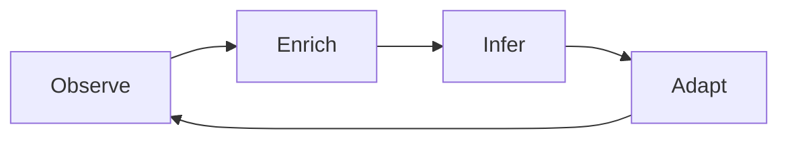

## はじめに

2026 年 10 月 16 日、Netflix Technology Blog に [Ontology-Driven Observability: Building an End-to-End Knowledge Graph at Netflix Scale](https://netflixtechblog.com/ontology-driven-observability-building-an-end-to-end-knowledge-graph-at-netflix-scale-421392cf5adf) が公開されました。障害調査で「システム横断の関係を人が頭の中でつなぎ直す時間が長い」という問題に対し、**Observability Ontology** と **QuipuDB** 上のナレッジグラフ、Enricher、Correlation Engine、Knowledge Flywheel、AutoRCA までを一連の設計として紹介しています。

同テーマの概要は 2026 年 3 月の [QCon London](https://qconlondon.com/presentation/mar2026/ontology-driven-observability-building-e2e-knowledge-graph-netflix-scale) でも発表済みです。当時、整理した記事は [QCon London 2026：Netflix の E2E ナレッジグラフ（オントロジー駆動の Observability）](https://zenn.dev/knowledge_graph/articles/netflix-qcon-e2e-knowledge-graph) にあります。10 月の記事はより具体的な実装を扱います。

末尾では、運用オントロジーを **UDA** のドメインモデリング言語 **Upper** と統合する計画も出てきます（コンテンツ・データ向けの UDA／Upper 自体は、別の TechBlog などで説明されている基盤です）。

---

## 時系列の整理

| 時期                | 出来事                                                                                                                                                                                                                               |
| ------------------- | ------------------------------------------------------------------------------------------------------------------------------------------------------------------------------------------------------------------------------------ |
| 2025 年 6 月        | TechBlog で [UDA（Unified Data Architecture）](https://netflixtechblog.com/model-once-represent-everywhere-uda-unified-data-architecture-at-netflix-6a6aee261d8d) が公開される                                                       |
| 2025 年 12 月       | InfoQ などで Upper メタモデルに関する報道（[Breaking Silos: Netflix Introduces Upper Metamodel…](https://www.infoq.com/news/2025/12/netflix-upper-uda-architecture/)）                                                               |
| 2026 年 3 月        | [QCon London](https://qconlondon.com/presentation/mar2026/ontology-driven-observability-building-e2e-knowledge-graph-netflix-scale) で概要発表（[InfoQ 会議レポート](https://www.infoq.com/news/2026/03/ontology-at-netflix/) など） |
| 2026 年（以降）     | [InfoQ 講演記録（動画・文字起こし）](https://www.infoq.com/presentations/netflix-observability-aiops-ontology-scale/) が公開される                                                                                                   |
| 2026 年 10 月 16 日 | 上記 TechBlog で Observability Ontology と周辺システムの詳細、Upper 統合の方針                                                                                                                                                       |

---

## Observability Ontology と Upper の統合

Netflix は **What comes next** で、Observability Ontology を **Upper**（UDA のドメインモデリング言語）と統合する計画を掲げています。Upper はドメインを機械可読なモデルとして書き、スキーマや各システムへ投影しながら意味と制約を保つものです。統合により、アプリケーション・アラート・デプロイ・インシデントなどの運用概念を Netflix 全体のドメインモデルにつなぎ、エンジニアとエージェントが同じ意味層で問い合わせ・検証・推論できるようにすることが目的です。最初のステップはインシデントを Upper でモデル化する PoC で、そこから学びをもとに両システムの接点を決めています。

UDA や Upper の全体像は [UDA TechBlog（2025-06）](https://netflixtechblog.com/model-once-represent-everywhere-uda-unified-data-architecture-at-netflix-6a6aee261d8d) など別記事の範囲です。

---

## 問題設定と MELT

記事は、ホーム画面のレンダリング遅延のような回帰を例に、調査に約 4 時間かかる場面から始まります。難しい計算より、観測基盤がすでに知っている関係を、人や機械がそのまま読み取れる形に書き残していなかったことが、時間の大半を占めます。

メトリクス・イベント・ログ・トレース（MELT）は調査の材料として有効です。一方、Atlas・Radar・incident.io・PagerDuty・Spinnaker・Slack はそれぞれ内部では一貫していますが、システム間では同じ実体を application／service／cluster など別の呼び方で扱い、結合には人がマッピングを覚えている必要があります。Netflix は、エンドツーエンド Observability の難しさを、こうしたデータモデリングの問題として位置づけています。

AI エージェントを使う場合も、文脈が足りなければ誤分析のリスクがあります。運用世界の実体について、明示的で機械可読な合意が必要になります。

---

## Observability Ontology と QuipuDB

**Observability Ontology** は、アプリケーション・サービス・インシデント・デプロイなどの型・属性・関係を定める定義です。単位はトリプル（subject, predicate, object）です。

技術スタックは RDF、OWL、SHACL、SPARQL。データはナレッジグラフとして **QuipuDB**（redb ベースの分散 quad store）に永続化します。テレメトリ・ログ・インシデントの議論などをパースしてトリプル化し、収集ごとに Turtle 全文も残して diff しやすくしています。オントロジーは 12 のネームスペースに分かれ、運用ドメインごとに所有されます。

設計判断として特に強く出ているのは次の 2 点です。

- **汎用の Service 型は採用しない。** ツール間で「サービス」の意味が異なるため、アプリケーションは `ops:Application` に統一し、約 49,000 件のソフトウェアカタログで検証してからエンティティを作る。未検証の文字列（ユーザー名、チーム名、トポロジーから拾った依存名など）はアプリケーションにならない。依存の辺（エッジ）は順方向と逆方向の両方向で件数上限を設け、人気サービスの逆依存がグラフを支配しないようにする。
- **インシデントの Slack など、人の推理もモデルする。** 仮説の試行錯誤や効いた緩和策など、チャネルに残る文脈を構造化トリプルに落とす。

オントロジーはコードとしてバージョン管理し、PR でレビューします。TBox と ABox も分けています。

---

## 非決定性から決定的なグラフへ

グラフを組み立てる途中では LLM による議論の要約、サービス名のファジー照合、因果連鎖の確率推定など実行ごとに結果がぶれる処理が入ります。出来上がったグラフは SPARQL で問い合わせたとき毎回同じ答えが返る決定的なデータにします。オントロジーの型で書けることを絞り、確率的な処理の出力をトリプルに落とします。記事ではその段取りを 5 層の図にしています。

---

## Enricher

**Enricher** はノイズの多い入力を読み、型付きトリプルを足すコンポーネントで、数十本がグラフ上で順に実行されます。各 Enricher は `rdf:type`、URI の命名規則、`ops:Application` のカタログゲートなどの契約に従います。パイプラインは**逐次実行**で競合を避けます。外部 API 呼び出しは **best-effort** で、呼び出し先が遅いときはその Enricher の結果だけ欠けたグラフで進め、収集全体は止めません。メトリクスやアラート向けの別オントロジーへ翻訳する作業も進めています。

---

## Correlation Engine

**Correlation Engine** は 13 種類の信号（ログエラー、メトリクス異常、遅延・失敗トレース、アラート、インシデント、デプロイ、設定変更、実験、オートスケール、コミット、E2E ボトルネック、エラーパターンなど）を読み、因果または相関の連鎖を探します。デプロイの後にログエラー、といった既知の順序には高い事前重みを置き、10 分の時間枠で時間的近接と重大度をスコアします。**信頼度 0.6 未満は破棄**します。

役割は結論を下すのではなく、**根拠付きで提案する**ことです。連鎖は、その根拠となったグラフ上のレコードとともに保存します。

---

## Knowledge Flywheel

各収集サイクルで **Observe → Enrich → Infer → Adapt** を回します。Observe で信号を集め、Enrich でトリプルを足し、Infer で生データでは見えないパターンを探し、Adapt で学んだパターンを検出ルールに戻す。一度見つかった因果は次のインシデントの既知パターンになり、オントロジーがスキーマから運用の記憶へ育つようになります。これは DevRev が実装している Shared Memory と非常に近いと考えられ、運用しているオントロジーを最新に保ち続けると、暗黙知が自然に組織の記憶になる、と捉えられます。

---

## AutoRCA

**AutoRCA** は、記事冒頭のような回帰をたどる内部向けのエージェントシステムで、グラフ上に specialist エージェント群を載せています。オントロジーがエージェント間の共通語彙になり、各専門エージェントはトリプルで findings を書き、他の専門家の存在を知らなくても同じ `ops:Application` などを読めます。

アラートは依然として鳴り、エンジニアが証拠を評価し、修正はコードを理解する人が書きます。短くなるのは、担当チームの特定、リリース内容の再構成、四半期前の類似事例の想起など、**文脈を組み立てる部分**です。ランク付き仮説は誤ることもあるため、各仮説には根拠が付きます。

エージェントや Enricher、オントロジー変更の提案は人のレビューを通す。これも **If you want to build one of these** の原則のひとつです。

ここについても運用をしばらくしていくと既知の事象が増えていき、修正自体も AI エージェントが自動で行えるタイミングが来る、と考えています。人が対応すべきなのは、より高度な未知の事象になるだけで、全体のスループットは大きく向上すると見ています。

---

## 構築原則（If you want to build one of these）

記事末尾で挙げる原則は次のとおりです。

- 何より先に**同一性**をモデルする。エンティティ種ごとに authoritative なカタログを一つ選び、作成前に検証する。
- オントロジーを**コードとして扱う**（バージョン、レビュー、テスト、PR）。
- **概念とインスタンスを分ける**
- **RDF／OWL／SHACL／SPARQL** などの公開標準を使う
- 確率的ツールは**型システムで出力を制約**する（特に強く推奨）
- Enrichment は **best-effort で順序付き**。外部 API が遅い・落ちているときは、その Enricher で足せるトリプルが減るだけにして、収集パイプライン全体は止めない
- **機械テレメトリと人の推理の両方**をモデルする（議論のエッジが特に価値が高い）
- **人を承認者に残す**。エージェントは提案し、変更はレビューに回す

---

## What comes next（記事の展望）

Netflix は、このグラフの上に仮説付きの自動 RCA や、十分な信頼度での自動修復、将来的にはユーザー影響前の予測と自己修復、という段階を描いています。Upper 統合は冒頭の「Observability Ontology と Upper の統合」のとおりです。

---

## まとめ

2026 年 10 月 16 日の TechBlog は、大規模運用で横断調査が遅くなる理由をデータモデリングの問題として捉え、Observability Ontology・QuipuDB・Enricher・Correlation Engine・Knowledge Flywheel・AutoRCA を一つのストーリーにまとめています。UDA／Upper との統合は計画段階でインシデントの Upper モデルから PoC を始めます。

---

## 本ブログの関連記事

| テーマ                 | 記事                                                                                                                          |
| ---------------------- | ----------------------------------------------------------------------------------------------------------------------------- |
| 2026 年 3 月概要の整理 | [QCon London 2026：Netflix の E2E ナレッジグラフ](https://zenn.dev/knowledge_graph/articles/netflix-qcon-e2e-knowledge-graph) |

---

## 参考

- [Ontology-Driven Observability: Building an End-to-End Knowledge Graph at Netflix Scale](https://netflixtechblog.com/ontology-driven-observability-building-an-end-to-end-knowledge-graph-at-netflix-scale-421392cf5adf)（Netflix Technology Blog, 2026-10-16）
- [Model Once, Represent Everywhere: UDA (Unified Data Architecture) at Netflix](https://netflixtechblog.com/model-once-represent-everywhere-uda-unified-data-architecture-at-netflix-6a6aee261d8d)（Netflix Technology Blog）
- [Breaking Silos: Netflix Introduces Upper Metamodel to Bring Consistency across Content Engineering](https://www.infoq.com/news/2025/12/netflix-upper-uda-architecture/)（InfoQ）
- [Unlocking Entertainment Intelligence with Knowledge Graph](https://netflixtechblog.medium.com/unlocking-entertainment-intelligence-with-knowledge-graph-da4b22090141)（Netflix Technology Blog）
- [QCon London 2026 — Ontology‐Driven Observability（セッションページ）](https://qconlondon.com/presentation/mar2026/ontology-driven-observability-building-e2e-knowledge-graph-netflix-scale)
- [InfoQ — QCon London 2026: Ontology‐Driven Observability（会議レポート）](https://www.infoq.com/news/2026/03/ontology-at-netflix/)
- [InfoQ — Ontology-Driven Observability at Netflix Scale（講演記録・動画・文字起こし）](https://www.infoq.com/presentations/netflix-observability-aiops-ontology-scale/)

---

## 更新履歴

- 2026-10-25: 初版公開

## フィードバック受け付け

本記事は AI を活用して執筆しています。ご意見については Zenn のコメントでお知らせください。
